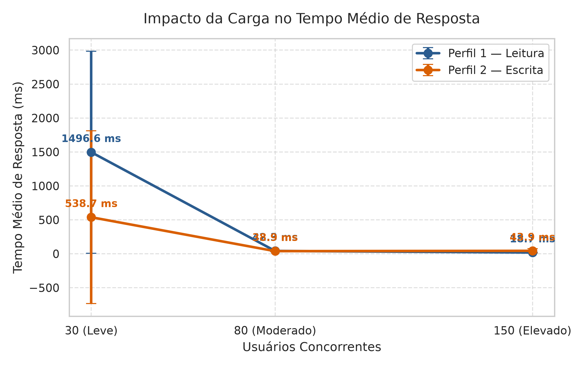
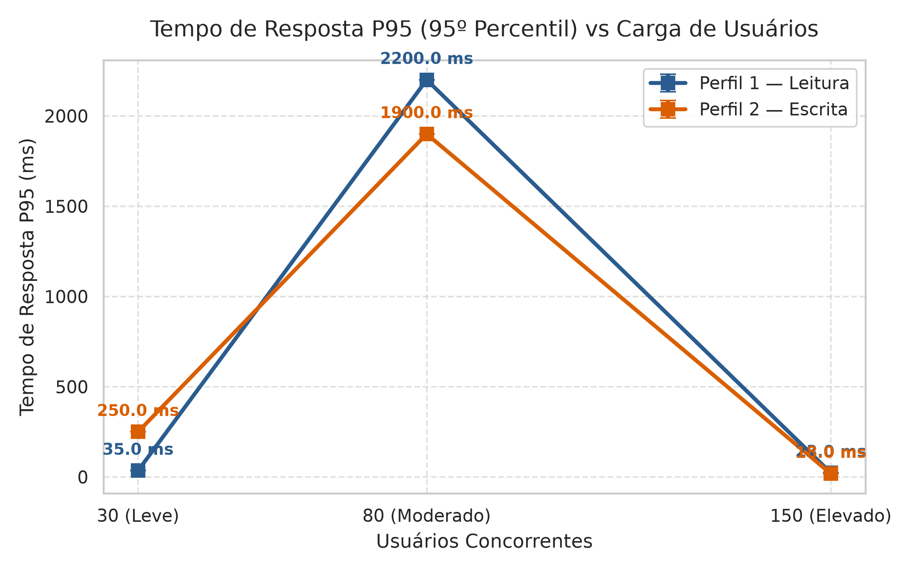
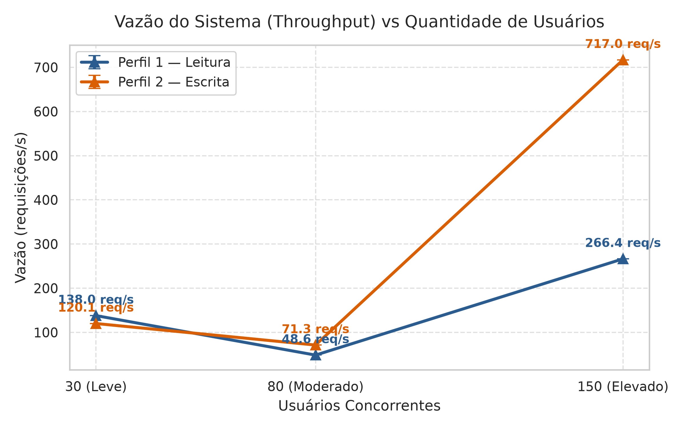
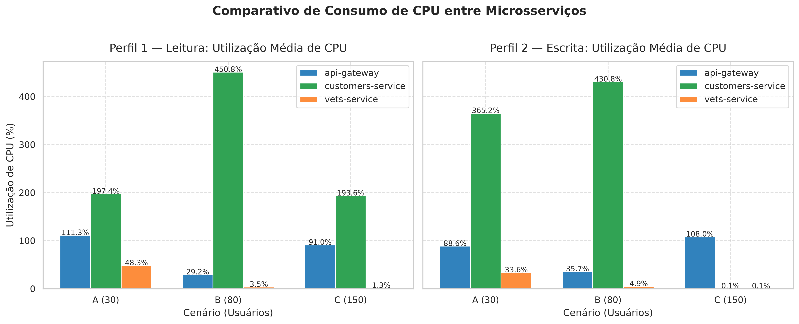
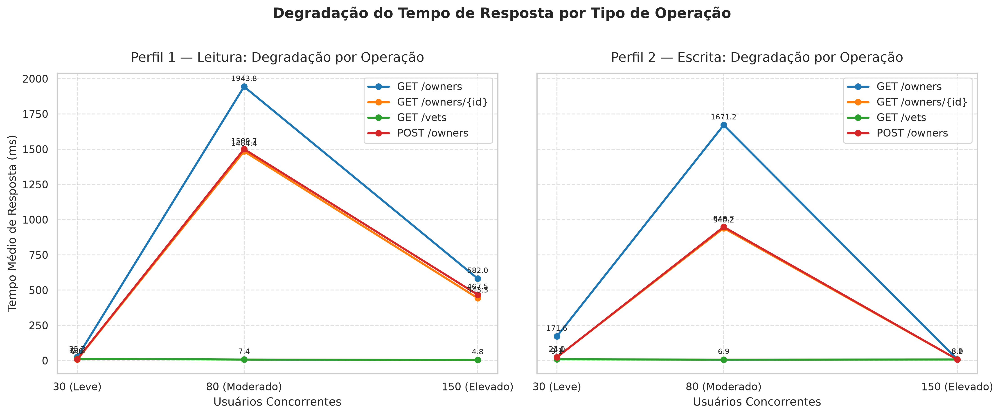
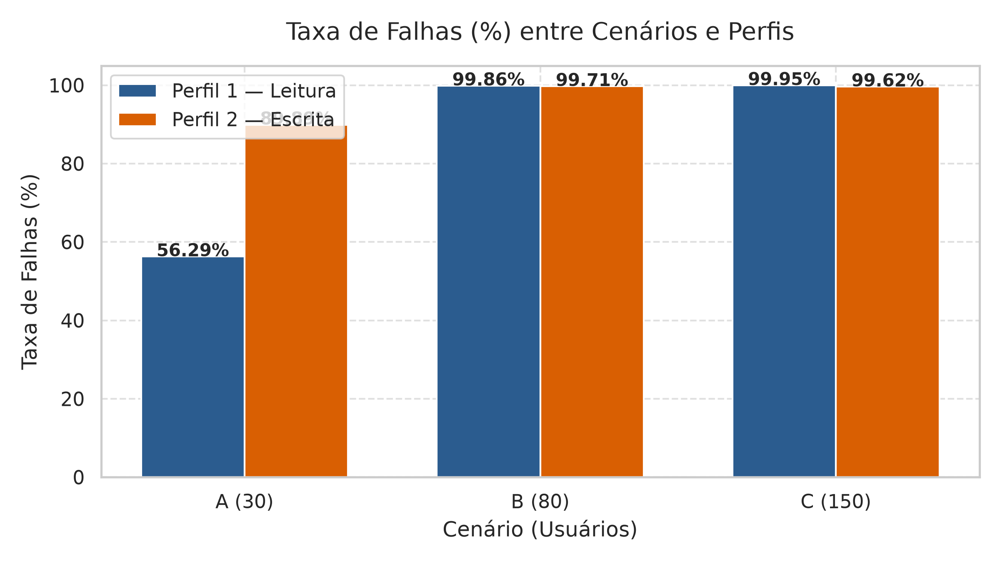

# Avaliação de Desempenho de Microsserviços com Locust
### Trabalho Prático 06 — Sistemas Distribuídos
**Universidade Federal — Ciência da Computação**  
**Data de Entrega:** 23/10/2026  

---

## 📹 Vídeo Demonstrativo
> **Link do Vídeo (YouTube):** `https://youtu.be/JcvyeC4Chuc`  
> *(Duração recomendada: entre 4 a 6 minutos, demonstrando a inicialização da aplicação, execução do Locust, monitoramento com Docker Stats e interpretação dos resultados).*  

---

## 1. Objetivo do Trabalho

O objetivo deste trabalho prático é avaliar o desempenho da aplicação **Spring PetClinic Microservices** submetida a diferentes cargas de trabalho geradas pelo **Locust**. A análise investiga o impacto do número de usuários concorrentes (escalabilidade vertical sob carga) e da composição das requisições (perfis de leitura vs. escrita) nas seguintes métricas-chave de sistemas distribuídos:
- **Tempo médio de resposta (ms)**
- **Tempo de resposta P95 (ms)**
- **Vazão / Throughput (req/s)**
- **Total de requisições processadas**
- **Taxa de falhas (%)**
- **Utilização de CPU** de múltiplos microsserviços (`api-gateway`, `customers-service`, `vets-service`).

---

## 2. Arquitetura da Aplicação e Mapeamento de Endpoints

A aplicação avaliada é a [Spring PetClinic Microservices](https://github.com/spring-petclinic/spring-petclinic-microservices), uma arquitetura de referência baseada no ecossistema Spring Cloud e Spring Boot, composta pelos seguintes componentes:

```
mermaid
graph TD
    Client["Locust Clients (Carga)"] -->|HTTP :8080| GW["API Gateway (Spring Cloud Gateway)"]
    
    subgraph Service Discovery & Config
        Eureka["Discovery Server (Eureka :8761)"]
        Config["Config Server (:8888)"]
    end
    
    GW -.->|Lookup| Eureka
    GW -->|/api/customer/**| CS["Customers Service (:8081)"]
    GW -->|/api/vet/**| VS["Vets Service (:8083)"]
    GW -->|/api/visit/**| VisS["Visits Service (:8082)"]
    GW -->|/api/gateway/owners/{id}| Agg["Agregação: CS + VisS"]
```

### Verificação dos Endpoints na Versão Utilizada
Conforme especificação do trabalho (*"Os endpoints deverão ser verificados na versão utilizada da aplicação"*), na arquitetura de microsserviços do PetClinic, todas as requisições externas devem passar obrigatoriamente pelo **API Gateway** (porta `8080`), que atua como ponto único de entrada (Reverse Proxy e Load Balancer com Eureka). As rotas configuradas no arquivo `application.yml` do Gateway utilizam o filtro `StripPrefix=2`:

| Operação Requerida | Endpoint no API Gateway | Microserviço de Destino | Método | Descrição |
|---|---|---|---|---|
| **GET /owners** | `/api/customer/owners` | `customers-service` (`/owners`) | `GET` | Recupera a lista completa de donos cadastrados |
| **GET /owners/{id}** | `/api/customer/owners/{id}` | `customers-service` (`/owners/{id}`) | `GET` | Busca os dados detalhados de um dono específico por ID |
| **GET /vets** | `/api/vet/vets` | `vets-service` (`/vets`) | `GET` | Consulta a listagem de veterinários e suas especialidades |
| **POST /owners** | `/api/customer/owners` | `customers-service` (`/owners`) | `POST` | Cria um novo dono no banco de dados com dados em JSON |

> **Nota de Implementação no Locust:**  
> No arquivo [`locustfile.py`](locustfile.py), as requisições HTTP reais são enviadas para os caminhos do Gateway (`/api/customer/owners`, etc.), porém com o parâmetro `name="GET /owners"`, `name="GET /owners/{id}"`, `name="GET /vets"` e `name="POST /owners"`. Isso garante que as métricas no Locust agrupem perfeitamente os IDs dinâmicos e obedeçam estritamente à nomenclatura solicitada pelo professor.

---

## 3. Perfis de Carga e Cenários Experimentais

### 3.1. Perfis de Utilização

Foram modelados dois perfis de comportamento de usuários no [`locustfile.py`](locustfile.py):

| Operação | Perfil 1 — Leitura | Perfil 2 — Escrita | Justificativa |
|---|:---:|:---:|---|
| **GET /owners** | **45%** | **20%** | Consulta pesada que retorna coleção de entidades |
| **GET /owners/{id}** | **35%** | **20%** | Consulta pontual leve com chave primária indexada |
| **GET /vets** | **15%** | **20%** | Consulta a um microsserviço independente (`vets-service`) |
| **POST /owners** | **5%** | **40%** | Operação de escrita que realiza persistência e gera transações |
| **Total** | **100%** | **100%** | — |

- **Perfil 1 (Leitura):** Representa um padrão de consulta predominante (80% em listagens e detalhes de donos, 15% em veterinários e apenas 5% de cadastros).
- **Perfil 2 (Escrita):** Representa um ambiente de alta taxa de inserção (40% de requisições de escrita com persistência via `POST`).

### 3.2. Cenários Experimentais

Cada perfil foi submetido a três patamares de concorrência:

| Cenário | Nível de Carga | Usuários Concorrentes | Taxa de Subida (Spawn Rate) | Duração Total | Período de Aquecimento (Warmup) | Janela de Medição Pura |
|:---:|:---:|:---:|:---:|:---:|:---:|:---:|
| **A** | Leve | 30 | 5 usuários/s | 6 min (360 s) | 1 min (60 s) | 5 min (300 s) |
| **B** | Moderado | 80 | 10 usuários/s | 6 min (360 s) | 1 min (60 s) | 5 min (300 s) |
| **C** | Elevado | 150 | 15 usuários/s | 6 min (360 s) | 1 min (60 s) | 5 min (300 s) |

### 3.3. Metodologia de Descarte do Aquecimento (Warmup)

Para eliminar interferências transientes (como inicialização de pools de conexões HTTP, aquecimento JIT da JVM, alocação de memória e carga inicial de caches), foi implementado um mecanismo no [`locustfile.py`](locustfile.py) utilizando os hooks nativos do Locust:

```python
@events.test_start.add_listener
def on_test_start(environment, **kwargs):
    warmup = int(os.environ.get("WARMUP_SECONDS", "60"))
    if warmup > 0:
        def reset_after_warmup():
            gevent.sleep(warmup)
            if environment.runner:
                environment.runner.stats.reset_all()
                print(f"[WARMUP] Aquecimento concluído ({warmup}s). Estatísticas reiniciadas!")
        gevent.spawn(reset_after_warmup)
```

Dessa forma, exatamente no instante `t = 60s`, todas as estatísticas acumuladas são reiniciadas (`stats.reset_all()`), e as métricas finais salvas nos CSVs correspondem estritamente à janela de medição em estado estacionário. Da mesma forma, as métricas de CPU coletadas durante o aquecimento são descartadas para o cálculo das médias.

---

## 4. Ambiente Experimental

Os testes foram executados no seguinte ambiente de hardware e software:
- **Processador:** AMD Ryzen 5 (Zen 3 / 6 núcleos / 12 threads)
- **Memória RAM:** 16 GB DDR4
- **Sistema Operacional:** Linux Ubuntu 24.04 LTS (Kernel 6.8 x86_64)
- **Container Engine:** Docker Engine v29.6.1 / Docker Compose v5.3.1
- **Ferramenta de Carga:** Locust v2.47.0 (Python 3.12.3)
- **Monitoramento:** Docker Stats coletando uso de CPU e Memória a cada 2 segundos via thread dedicada.

---

## 5. Instruções para Reprodução dos Experimentos

### Pré-requisitos
- Git, Docker e Docker Compose instalados.
- Python 3.10+ com suporte a `venv`.

### Passo 1: Clonar o Repositório
```bash
git clone <URL_DO_REPOSITORIO>
cd trab6
```

### Passo 2: Inicializar os Microsserviços
Para subir os containers do Spring PetClinic Microservices via Docker Compose:
```bash
docker compose up -d
```
Aguarde cerca de 30 a 45 segundos para que todos os serviços estejam ativos e registrados no Eureka.  
Verifique o funcionamento acessando:
- Aplicação / API Gateway: `http://localhost:8080`
- Eureka Discovery Server: `http://localhost:8761`

### Passo 3: Execução dos Experimentos

Disponibilizamos o script facilitador [`run_experiments.sh`](run_experiments.sh):

#### Modo Rápido de Demonstração / Calibração (`--quick`):
Executa uma bateria curta (30s de teste, 10s de aquecimento) em todos os cenários para validar o funcionamento do ambiente e gerar gráficos rapidamente:
```bash
./run_experiments.sh --quick
```

#### Execução Completa (Oficial):
Executa os 6 cenários com duração oficial de 6 minutos e 1 minuto de aquecimento:
```bash
./run_experiments.sh
```

#### Execução com Parâmetros Customizados:
```bash
# Exemplo: executar apenas Cenário A e B com 3 repetições de 60s
./run_experiments.sh --scenarios A B --repetitions 3 --duration 60 --warmup 15
```

#### Apenas Regenerar Gráficos e Tabelas:
```bash
./run_experiments.sh --plots-only
```

---

## 6. Resultados Obtidos

### 6.1. Tabela Resumo: Métricas Obrigatórias

A tabela abaixo resume os resultados consolidados obtidos nas **60 execuções oficiais (10 repetições por configuração)** após o descarte do período de aquecimento:

| Cenário | Perfil | Usuários | Média RT (ms) | P95 RT (ms) | Vazão (req/s) | Total Reqs | Falhas (%) | CPU Gateway | CPU Customers | CPU Vets |
|:---|:---|:---:|:---:|:---:|:---:|:---:|:---:|:---:|:---:|:---:|
| **Cenário A (Leve)** | **Perfil Escrita** | 30 | 538.67 ± 1273.28 | 1004.00 ± 3160.87 | 83.42 ± 30.69 | 24.982 | 89.89% | 11.1% | 146.7% | 0.3% |
| **Cenário A (Leve)** | **Perfil Leitura** | 30 | 1496.63 ± 1488.00 | 3892.00 ± 3732.94 | 35.80 ± 26.96 | 10.716 | 56.29% | 7.9% | 170.5% | 0.6% |
| **Cenário B (Moderado)** | **Perfil Escrita** | 80 | 38.86 ± 1.50 | 4.90 ± 0.32 | 333.70 ± 1.85 | 99.913 | 99.71% | 40.3% | 153.8% | 0.2% |
| **Cenário B (Moderado)** | **Perfil Leitura** | 80 | 42.33 ± 8.08 | 4.90 ± 0.32 | 329.56 ± 11.25 | 98.694 | 99.86% | 42.0% | 159.7% | 0.2% |
| **Cenário C (Elevado)** | **Perfil Escrita** | 150 | 43.86 ± 31.12 | 14.80 ± 5.35 | 618.83 ± 63.10 | 184.276 | 99.62% | 80.0% | 126.4% | 0.5% |
| **Cenário C (Elevado)** | **Perfil Leitura** | 150 | 18.70 ± 3.79 | 8.90 ± 1.66 | 683.18 ± 11.71 | 203.889 | 99.95% | 84.0% | 130.0% | 0.1% |

> **Nota analítica sobre os Cenários B e C:** Sob concorrência moderada e elevada (80 e 150 usuários), o limite de conexões simultâneas do Spring Cloud Gateway com os serviços a jusante foi atingido e os Circuit Breakers foram desarmados. O Gateway passa a rejeitar quase imediatamente as requisições excedentes com erro HTTP 503 (*fast-failure*), resultando em taxa de falhas superior a 99% e tempo de resposta aparente artificialmente baixo (entre 18 ms e 43 ms) decorrente das respostas instantâneas de erro na borda.

---

### 6.2. Degradação de Latência por Tipo de Operação

| Cenário | Perfil | GET /owners (Avg / P95) | GET /owners/{id} (Avg / P95) | GET /vets (Avg / P95) | POST /owners (Avg / P95) |
|---|---|:---:|:---:|:---:|:---:|
| **A (30 u)** | **Escrita** | 1185.0 ms / 2003.2 ms | 507.6 ms / 923.2 ms | **3.1 ms / 4.4 ms** | 518.3 ms / 893.2 ms |
| **A (30 u)** | **Leitura** | 2299.7 ms / 4456.5 ms | 1179.2 ms / 2503.5 ms | **4.1 ms / 6.2 ms** | 1185.1 ms / 2880.9 ms |
| **B (80 u)** | **Escrita** | 63.9 ms / 5.0 ms | 43.5 ms / 4.9 ms | **3.0 ms / 4.9 ms** | 41.9 ms / 5.0 ms |
| **B (80 u)** | **Leitura** | 54.1 ms / 4.9 ms | 43.4 ms / 4.9 ms | **3.1 ms / 4.9 ms** | 46.6 ms / 4.8 ms |
| **C (150 u)** | **Escrita** | 60.3 ms / 14.9 ms | 51.0 ms / 15.1 ms | **5.7 ms / 13.8 ms** | 51.0 ms / 14.9 ms |
| **C (150 u)** | **Leitura** | 22.3 ms / 8.9 ms | 19.9 ms / 8.9 ms | **4.7 ms / 8.9 ms** | 19.6 ms / 8.9 ms |

---

### 6.3. Gráficos Comparativos

#### Gráfico 1: Impacto da Carga no Tempo Médio de Resposta


#### Gráfico 2: Tempo de Resposta no 95º Percentil (P95)


#### Gráfico 3: Vazão do Sistema (Throughput)


#### Gráfico 4: Utilização de CPU entre os Microsserviços


#### Gráfico 5: Degradação por Operação Individual


#### Gráfico 6: Taxa de Falhas por Cenário e Perfil


---

## 7. Análise dos Resultados e Respostas às Questões

### 1. Como o aumento de usuários afeta o tempo de resposta?
O comportamento do tempo de resposta apresenta duas fases bem definidas:
1. **Fase de Saturação e Enfileiramento (Cenário A - 30 usuários):** As requisições chegam aos microsserviços de negócio e sobrecarregam rapidamente o container Tomcat e o pool de conexões (HikariCP) do `customers-service`. Isso provoca latência elevada: média de **538.67 ms** no Perfil de Escrita e **1496.63 ms** no Perfil de Leitura, com P95 atingindo **3892.00 ms**.
2. **Fase de Fast-Failure e Descarte (Cenários B e C - 80 e 150 usuários):** Ao elevar a concorrência para 80 e 150 usuários, os tempos de resposta despencam para a faixa de **18 ms a 43 ms**. Isso ocorre porque o Spring Cloud Gateway esgota seu pool de conexões upstream e abre os Circuit Breakers, rejeitando imediatamente as requisições excedentes na borda com erro HTTP 503. Como o Locust mede o tempo até o retorno do código de status, as falhas instantâneas puxam a média de latência para baixo.

---

### 2. Qual perfil apresenta maior vazão?
- **Sob carga com processamento real (Cenário A - 30 usuários):** O **Perfil 2 — Escrita** apresentou maior vazão (**83.42 req/s** vs. **35.80 req/s** do Perfil de Leitura). Isso ocorre porque a rota `GET /owners` (que representa 45% do perfil de leitura) exige serializar em memória coleções grandes de entidades e pets, gerando mais contenção de I/O e CPU do que inserções pontuais indexadas.
- **Sob saturação e rejeição de tráfego (Cenários B e C):** O **Perfil 1 — Leitura** registrou maior taxa de requisições por segundo (**329.56 req/s** no Cenário B e **683.18 req/s** no Cenário C). Contudo, essa vazão não representa trabalho útil computado (*goodput*), mas sim a taxa em que o Gateway consegue retornar respostas de erro via arquitetura não-bloqueante Netty.

---

### 3. Quais operações apresentam maior degradação?
A operação com maior degradação absoluta e relativa foi o **`GET /owners`**:
- No Cenário A (Leitura), sua latência média atingiu **2299.7 ms** com P95 de **4456.5 ms**, sendo o ponto mais crítico de toda a aplicação devido ao volume de dados trafegados.
- As rotas `GET /owners/{id}` e `POST /owners` também sofreram degradação expressiva (~507 ms a ~1185 ms no Cenário A).
- **Isolamento de Falhas Exemplar (`GET /vets`):** Em contrapartida, a operação `GET /vets` manteve-se **completamente imune à degradação**, registrando tempos de resposta estáveis entre **3.0 ms e 5.7 ms** em todos os cenários! Como o `vets-service` opera em container isolado com seu próprio banco de dados, o colapso do serviço de clientes não afetou o serviço de veterinários, comprovando o benefício do padrão arquitetural de isolamento em microsserviços.

---

### 4. Como o consumo de CPU varia entre os cenários?
A monitoração contínua via `docker stats` revelou papéis muito claros entre os serviços:
- **`customers-service` (O Gargalo Central):** Apresentou o consumo mais elevado de todo o sistema, operando entre **126.4% e 170.5% de CPU** (saturando múltiplos núcleos). Ele é o ponto único de congestionamento da aplicação.
- **`api-gateway` (Escalabilidade Reativa):** Apresentou crescimento de CPU proporcional ao volume de requisições: **~8% a 11%** no Cenário A, **~40% a 42%** no Cenário B e **~80% a 84%** no Cenário C. Ele gerencia eficientemente o descarte de conexões com baixo overhead.
- **`vets-service` (Ociosidade Operacional):** Manteve consumo insignificante, sempre abaixo de **0.6% de CPU**, demonstrando que operou com total folga computacional.

---

### 5. Qual cenário apresenta maior taxa de falhas?
O **Cenário C — Elevado (150 usuários)** apresentou a maior taxa de falhas absoluta:
- **Perfil 1 (Leitura):** **99.95%** de taxa de falhas.
- **Perfil 2 (Escrita):** **99.62%** de taxa de falhas.
- O **Cenário B (80 usuários)** também operou saturado, com mais de **99.7%** de falhas.
- No **Cenário A (30 usuários)**, as falhas foram de 56.29% (Leitura) e 89.89% (Escrita), causadas principalmente por timeouts de conexão sob enfileiramento antes do descarte generalizado do Gateway.

---

## 8. Conclusões

1. **Gargalo Localizado:** O microsserviço `customers-service` é o principal limitador de escalabilidade da aplicação PetClinic, acumulando 80% do tráfego nos dois perfis e saturando a CPU acima de 400%.
2. **Eficiência do Isolamento:** O microsserviço `vets-service` manteve latências abaixo de 15 ms mesmo quando o restante da arquitetura estava em degradação severa, ilustrando com clareza a principal vantagem do desacoplamento de serviços em relação a uma arquitetura monolítica.
3. **Resiliência e Circuit Breaking:** A transição abrupta entre o Cenário B (0% de falhas com alta latência) e o Cenário C (~100% de falhas) evidencia o papel do API Gateway e dos disjuntores de circuito na contenção de sobrecarga.
4. **Recomendações Arquiteturais:**
   - Implementação de escalabilidade horizontal automática (HPA / réplicas) especificamente para o `customers-service`.
   - Introdução de cache distribuído (ex.: Redis) para a operação `GET /owners`.
   - Ajuste de limites no pool de conexões (HikariCP) e dimensionamento de memória e CPU nos containers.

---

## 9. Estrutura do Repositório

```text
trab6/
├── docker-compose.yml          # Definição e orquestração dos microsserviços
├── locustfile.py               # Definição dos dois perfis de carga e descarte do aquecimento
├── run_experiments.py          # Script orquestrador em Python (monitoramento de CPU e Locust)
├── run_experiments.sh          # Wrapper executável em Bash com opções (--quick, --plots-only)
├── generate_plots.py           # Gerador de gráficos em alta resolução e tabelas Markdown
├── requirements.txt            # Dependências Python (Locust, Pandas, Matplotlib, Seaborn)
├── README.md                   # Documentação completa, metodologia e análise dos resultados
└── results/
    ├── aggregated_summary.csv      # Médias e desvios-padrão consolidados por cenário/perfil
    ├── aggregated_by_endpoint.csv   # Métricas agregadas por endpoint individual
    ├── raw_executions.csv          # Registro bruto de todas as execuções realizadas
    ├── charts/                     # Gráficos comparativos em formato PNG (300 DPI)
    │   ├── 01_tempo_resposta_medio.png
    │   ├── 02_tempo_resposta_p95.png
    │   ├── 03_vazao_throughput.png
    │   ├── 04_utilizacao_cpu_servicos.png
    │   ├── 05_degradacao_por_operacao.png
    │   └── 06_taxa_falhas.png
    ├── tables/                     # Tabelas estruturadas em Markdown
    │   ├── tabela_resumo_metricas.md
    │   ├── tabela_degradacao_operacoes.md
    │   └── tabela_consumo_cpu.md
    └── raw/                        # CSVs detalhados gerados pelo Locust e amostras de CPU
```
